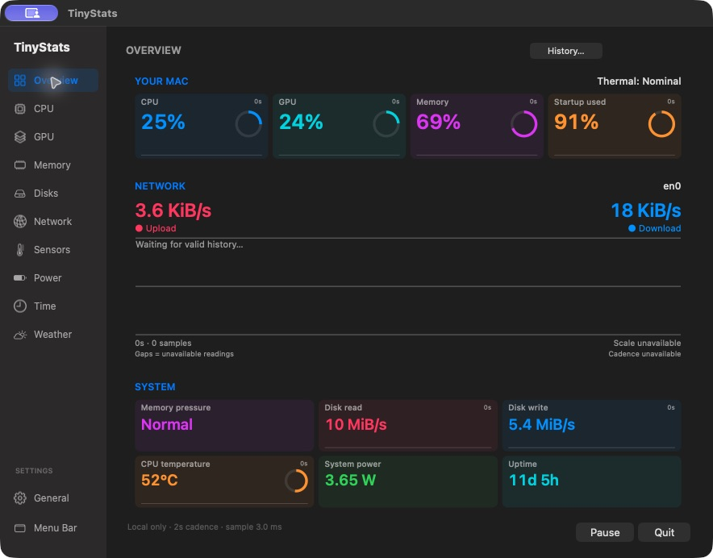
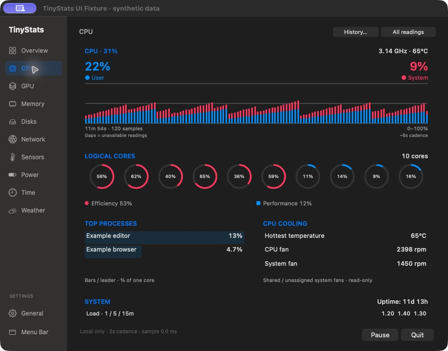
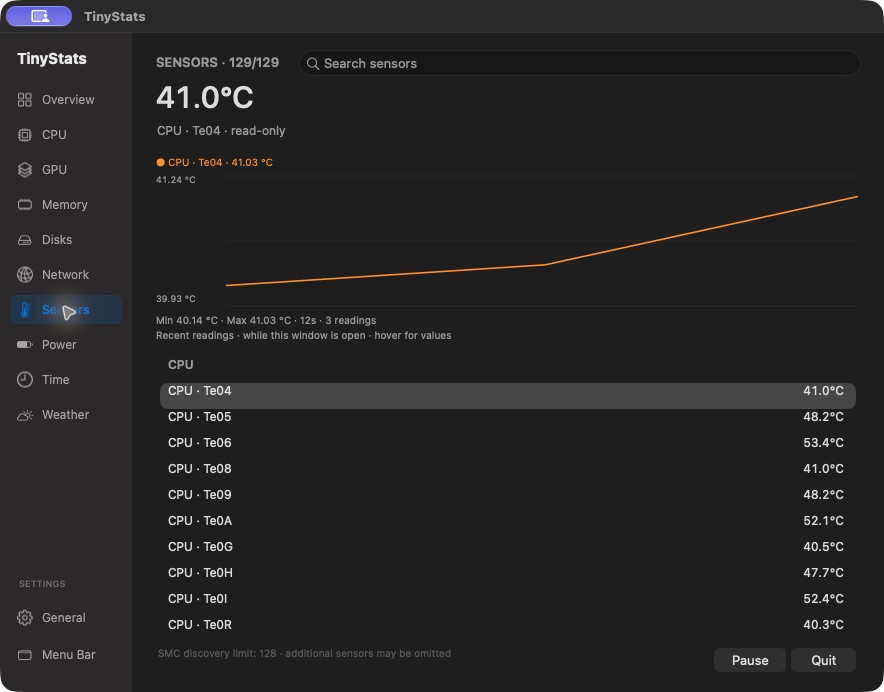
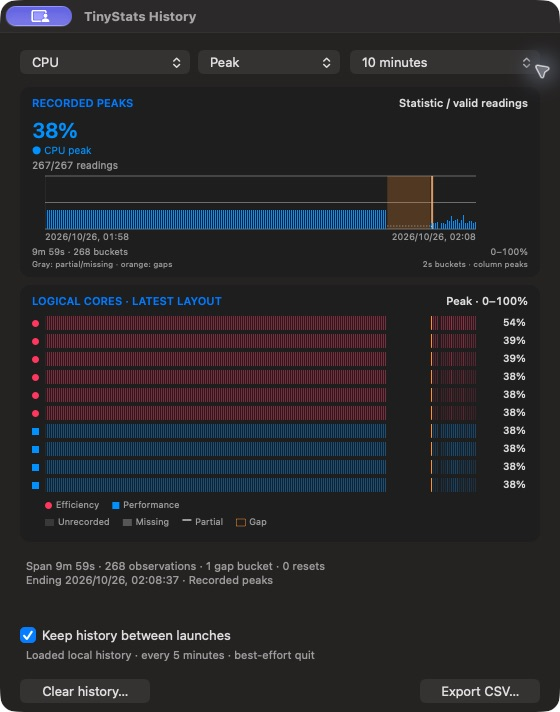
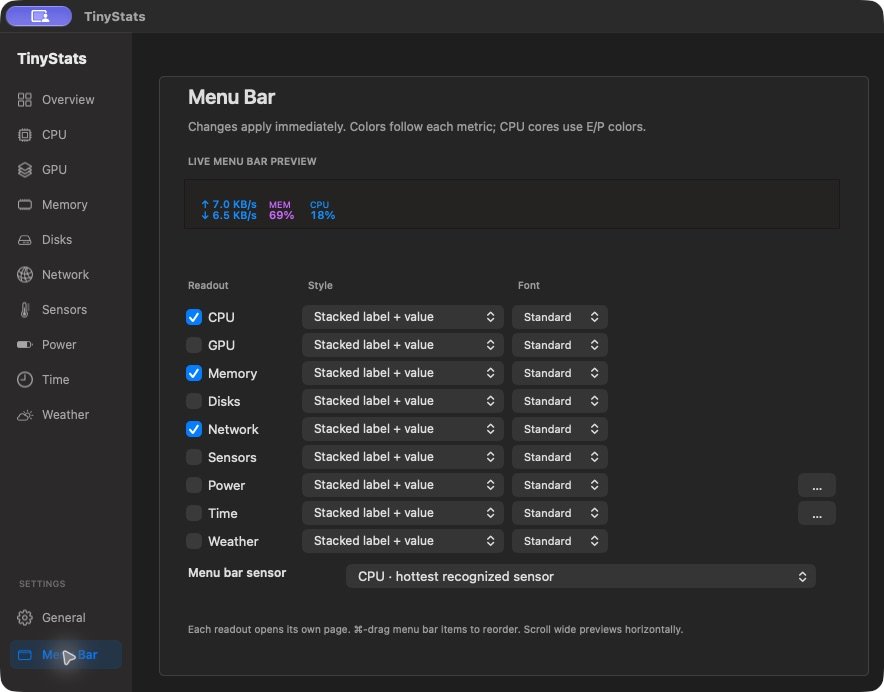

<p align="center">
  <picture>
    <source media="(prefers-color-scheme: dark)" srcset="docs/brand/logo-dark.svg">
    
  </picture>
</p>

# TinyStats

A native Swift and AppKit menu bar monitor for your Mac, with local system stats, permission-gated Weather and optional advanced internet checks.

TinyStats is an MIT-licensed, early-stage project working toward a lean, native alternative to commercial menu bar monitors. Contributions are welcome: bug reports, hardware diagnostics, documentation and code all help.



## Screenshots

| CPU | Sensors |
| --- | --- |
|  |  |
| **History** | **Menu bar settings** |
|  |  |

The CPU capture uses synthetic fixture data; the others are native captures on an Apple Silicon (M4) Mac.

## What it monitors

| Area | Available readings and features |
| --- | --- |
| CPU | Total and logical-core usage/history, E/P grouping, loads, uptime, top processes and supported Apple Silicon active frequencies |
| GPU | Driver utilization, model/memory and supported frequency/model-power readings; reported Metal time by accessible creating process |
| Memory | Estimated composition, OS memory pressure, swap and accessible process footprints |
| Disks | Local capacity, physical read/write rates, process I/O and read-only NVMe/ATA SMART where exposed |
| Network | Selected-interface traffic, addresses/routes/DNS, partial process/app-bundle traffic, Wi-Fi radio data and optional advanced HTTPS/public-IP/ping checks (off by default) |
| Sensors | Read-only temperatures, fan RPM, watts, volts, amps and OS thermal state, with Summary highlights and searchable raw keys in Advanced → Sensors |
| Power | Internal battery, accessories, energy mode and available power readings |
| Time | Month calendar, named world clocks, custom menu bar clocks and an optional advanced account-calendar agenda (off by default) |
| Weather | MET Norway model forecasts, temperature/conditions, precipitation, wind and local sunrise/sunset estimates |
| History and alerts | Bounded numeric history through 28 days, CSV export, configurable menu bar styles and opt-in notification rules |

Hardware support varies. Missing readings stay unavailable. Individual GPU-core activity, complete modern app traffic attribution and fan control remain unfinished. See the [roadmap](docs/ROADMAP.md) and [compatibility notes](docs/COMPATIBILITY.md).

## Requirements

- macOS 14 or newer. Apple Silicon is the primary target; the universal build also includes Intel (`x86_64`), which has had less runtime testing.
- To build: Xcode 16 or newer (Swift 6 toolchain). Python 3 for the optional validation and benchmark scripts.
- No third-party runtime package dependencies.

## Install (build from source)

There is no signed binary release yet. Build the app from source:

```sh
git clone https://github.com/niechen/tinystats.git
cd tinystats
scripts/build-app.sh --universal
open build/TinyStats.app
```

The build produces `build/TinyStats.app` and `build/TinyStats.zip`. Copy `TinyStats.app` to `/Applications` if you want to keep it. Run `swift test --build-system native` first if you want to run the test suite.

**Unsigned (ad-hoc) build.** Local builds are ad-hoc signed, not signed with a Developer ID or notarized by Apple. An app you built yourself on the same Mac normally opens directly. If you copy the app or ZIP to another Mac, Gatekeeper may block it: right-click (Control-click) the app in Finder and choose **Open**, or open it once and then use **System Settings → Privacy & Security → Open Anyway**. Do not disable Gatekeeper system-wide. Maintainers can sign with their own identity by setting `TINYSTATS_SIGN_IDENTITY`; see [Distribution](docs/DISTRIBUTION.md).

To launch TinyStats at login, enable **Launch at login** in Settings → General.

## Contributing changes

Before submitting code, tests, resources, packaging or validation changes, run the complete local check:

```sh
scripts/verify-local.sh
```

It runs the tests, format lint, strict warnings, universal packaging, signature checks and diagnostics, keeping logs in `build/ci`. Documentation-only changes need whitespace and factual/link checks; see [Contributing](CONTRIBUTING.md).

## Diagnostics and preview

```sh
# Local capabilities; no diagnostic upload.
build/TinyStats.app/Contents/MacOS/TinyStats --diagnose

# Includes a second slow-hardware sample for frequency/model-power checks.
build/TinyStats.app/Contents/MacOS/TinyStats --diagnose --hardware

# Persistent development window.
build/TinyStats.app/Contents/MacOS/TinyStats --preview
```

Review diagnostic output before sharing it using the [hardware report instructions](CONTRIBUTING.md#hardware-diagnostics). Measure Release overhead with `python3 scripts/benchmark-app.py --duration 60 --warmup 15`; methods, resource targets and observed limits are in [Performance](docs/PERFORMANCE.md).

## Welcome tour

On a brand-new install with no saved settings, a six-step native welcome window introduces the modules, lets you choose menu bar readouts/styles and local history saving, and links to the existing online/notification controls. Existing profiles with saved settings skip the tour silently on upgrade. The welcome flag is recorded before presentation, so closing, skipping or finishing never opens it automatically again for that preferences domain. Skip keeps the current settings. Right-click a readout and choose **Show welcome tour** to reopen it.

For isolated screenshots, use a disposable preferences domain instead of your normal profile:

```sh
TINYSTATS_PREFERENCES_DOMAIN=local.TinyStats.WelcomePreview build/TinyStats.app/Contents/MacOS/TinyStats --preview-onboarding --preview-onboarding-step 2
```

Steps 1–6 can be selected explicitly. The preview does not set the welcome flag; other isolated previews/benchmarks suppress automatic onboarding. Do not opt into online features while taking offline captures. Remove the disposable preferences domain after quitting.

## Privacy

- Local monitoring needs no TinyStats account and includes no analytics. Collection uses one shared scheduler; numeric history is bounded and stored locally. Saving defaults on, preserves an explicit Off choice, and offers Off/Clear controls in History. See [History](docs/HISTORY.md).
- **Weather is off by default on new installs; enabling it is an explicit opt-in.** No forecast or location requests happen until you turn it on. Current-location mode also requires TinyStats' own macOS location permission and an authorized location fix. Forecast requests go directly to **MET Norway (`api.met.no`)**, which receives rounded coordinates and your connection's public IP. Choosing manual coordinates or a saved city can provide a location without OS location permission; existing explicit Weather choices are preserved. Turn Weather off to stop requests. See [Weather privacy](docs/WEATHER.md).
- **Optional advanced: HTTPS checks, public-IP discovery and ICMP ping are separate opt-ins, off by default.** Open Settings → General → Online & Time advanced → Internet checks…; no requests occur until you enable and Save. Configured destinations may include Apple's HTTPS preset, a custom HTTPS URL, ipify (`api.ipify.org` / `api6.ipify.org`) and your chosen numeric ping address. Recipients see the connection's source IP. See [Internet checks](docs/INTERNET.md) for destinations and cadence.
- The optional advanced Calendar agenda is off by default (Settings → General → Online & Time advanced → Calendar…). Events require explicit access, are read only while the Time page is visible, and are neither persisted nor uploaded. Diagnostics and tests do not implicitly enable online features or request location. `--preview` is a development UI mode; review your normal app settings before using it.

## Get involved

Start with [CONTRIBUTING.md](CONTRIBUTING.md), the [roadmap](docs/ROADMAP.md) and our [Code of Conduct](CODE_OF_CONDUCT.md). Please report vulnerabilities privately through [Security](SECURITY.md).

The [changelog](CHANGELOG.md) records changes in each version.

## License

[MIT](LICENSE) © 2026 Nie Chen. Protocol research and adaptations are credited in [Third-party notices](THIRD_PARTY_NOTICES.md). TinyStats is independent of Bjango, Stats and MET Norway.
