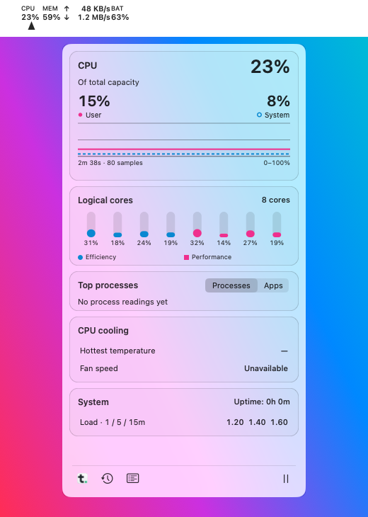
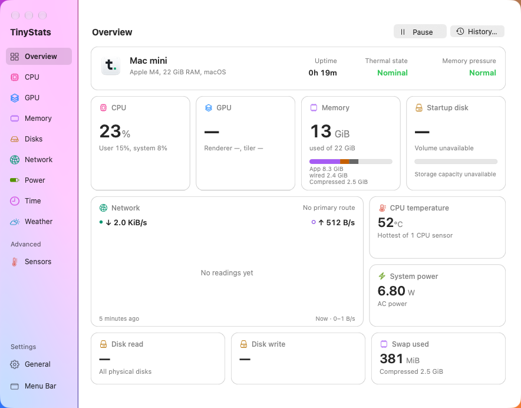
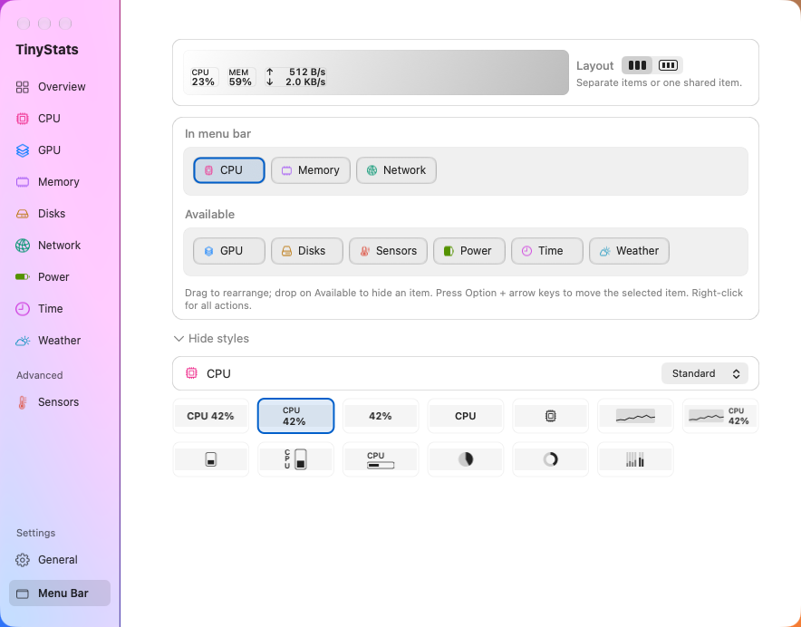
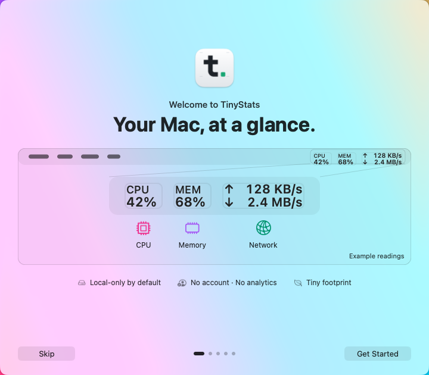
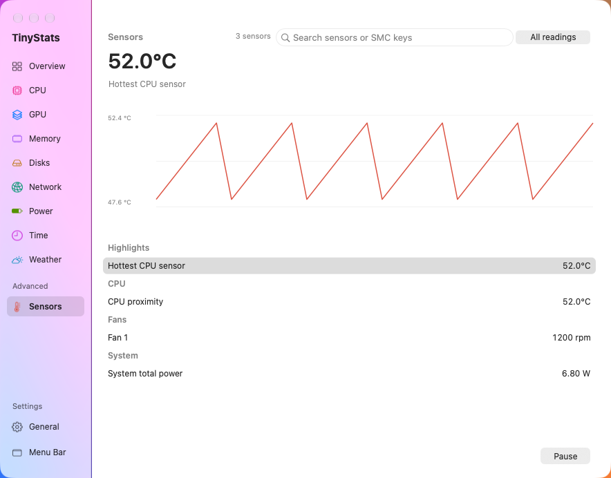
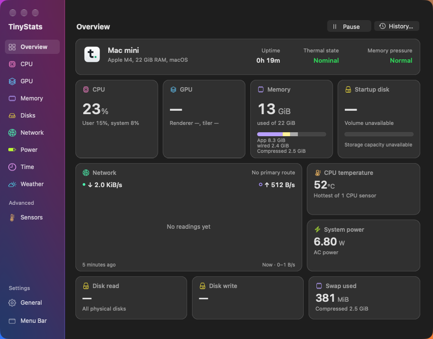
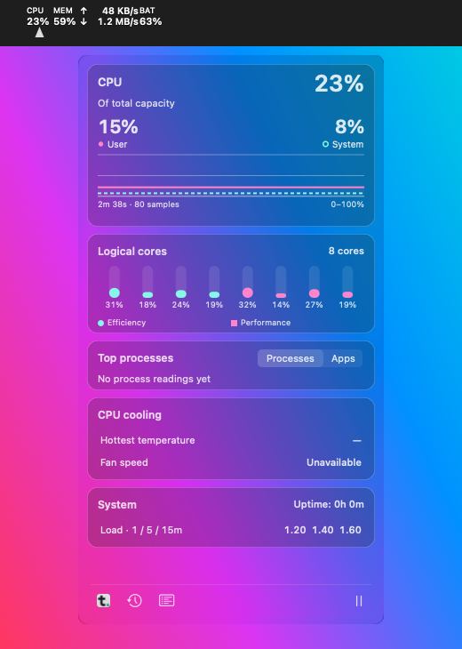

<p align="center">
  <picture>
    <source media="(prefers-color-scheme: dark)" srcset="docs/brand/logo-dark.svg">
    
  </picture>
</p>

<p align="center">
  <strong>A tiny, native macOS menu bar system monitor.</strong><br>
  CPU, GPU, memory, disks, network, sensors, battery and weather — one click away.
</p>

<p align="center">
  
  
  
  <a href="https://github.com/letsopen-ai/tinystats/releases"></a>
  <a href="LICENSE"></a>
</p>

<p align="center">
  <a href="#install">Install</a> ·
  <a href="#features">Features</a> ·
  <a href="#privacy">Privacy</a> ·
  <a href="#development">Development</a> ·
  <a href="docs/ROADMAP.md">Roadmap</a>
</p>

<p align="center">
  
</p>

<p align="center">
  
</p>

<p align="center">
  
</p>

## What is tinyStats?

tinyStats puts live readings from your Mac into the menu bar — CPU and GPU load, memory pressure, disk and network throughput, temperatures, fans and battery — and opens a detail window with history and the processes behind each number when you click it. It is written in Swift and AppKit with no third-party runtime dependencies, samples everything on one shared timer that slows down in Low Power Mode, and keeps monitoring data on your Mac, with no account or analytics. Signed releases check GitHub for updates daily (configurable in Settings › General). Weather and internet checks are optional and off by default.

It is an early-stage, MIT-licensed project working toward a lean, open alternative to commercial menu bar monitors.

## Features

| Module | What you get |
| --- | --- |
| 🧠 **CPU** | Total and per-core usage with efficiency/performance core grouping, load averages, uptime, top processes and Apple Silicon cluster frequencies |
| 🎮 **GPU** | Utilization, model and memory, plus frequency and model-power readings where supported |
| 🧮 **Memory** | Composition, OS memory pressure, swap and top processes by footprint |
| 💽 **Disks** | Volume capacity, read/write rates, per-process I/O and read-only NVMe/ATA SMART health |
| 🌐 **Network** | Interface traffic, addresses, routes, DNS, Wi-Fi radio details and partial per-process traffic from kernel TCP/UDP statistics |
| 🌡️ **Sensors** | Temperatures, fan speeds, watts, volts and amps, with a searchable sensor browser and live chart (read-only) |
| 🔋 **Power** | Internal battery, connected accessories, and per-source visibility (show the Power item on adapter, on battery, or both). The Power dropdown can also show Energy Mode (Low Power / Automatic / High Performance where `pmset` reports it); changing a mode requires an explicit click and a macOS administrator prompt |
| 🕑 **Time** | Month calendar, named world clocks, custom menu bar clocks and an optional calendar agenda |
| ⛅ **Weather** | Opt-in forecasts from MET Norway: temperature, conditions, precipitation, wind, sunrise and sunset |
| 📈 **History** | Up to 28 days of local numeric history with peak/average/minimum views, a per-core heatmap and CSV export |
| 🔔 **Alerts** | Opt-in notification rules for usage, pressure, throughput, sensors, battery, thermal state, SMART and more |
| 🎛️ **Menu bar** | Compact readouts in **Separate** (one item per module) or **One** (a single combined item) layout. Click a readout to open its dropdown; in One layout, click another module to switch in the same open dropdown. Give each module one of 14 styles — text, value or icon only, history graphs, gauges, pie, ring, per-core bars or a battery icon |

A five-step welcome tour on first launch helps you choose your menu bar readouts. The main window uses a native split for Overview, each module and Settings. Readings that your hardware does not expose are shown as unavailable rather than guessed.

<table>
  <tr>
    <td width="50%"></td>
    <td width="50%"></td>
  </tr>
  <tr>
    <td align="center"><sub><b>Overview</b> — native split, live cards and history</sub></td>
    <td align="center"><sub><b>Menu bar</b> — choose modules, layout and styles</sub></td>
  </tr>
  <tr>
    <td></td>
    <td></td>
  </tr>
  <tr>
    <td align="center"><sub><b>Welcome</b> — a five-step graphic tour on first launch</sub></td>
    <td align="center"><sub><b>Sensors</b> — searchable, read-only sensor browser</sub></td>
  </tr>
  <tr>
    <td></td>
    <td></td>
  </tr>
  <tr>
    <td align="center"><sub><b>Dark Mode</b> — Overview</sub></td>
    <td align="center"><sub><b>Dark Mode</b> — menu bar dropdown</sub></td>
  </tr>
</table>

<sub>Dropdown and menu-bar stills (and the demo GIF) are owned-window / gallery-mirror captures on a color backdrop, not a screenshot of the real menu bar, so they do not show a popover arrow. The Overview and Settings windows are the current native split. Some preview readings can be incomplete or fixture data — for example an empty process list or a Sensors chart from a gallery capture. A slightly sharper MP4 of the same dropdown sequence is at [docs/images/demo-dropdown.mp4](docs/images/demo-dropdown.mp4). Extra stills: the welcome tour's [menu bar step](docs/images/welcome-menubar-light.png) and [Menu Bar settings in Dark Mode](docs/images/menu-bar-settings-dark.png).</sub>

## Lightweight by design

One measured run compares tinyStats with iStat Menus 7:

| Metric | tinyStats | iStat Menus |
| --- | ---: | ---: |
| Memory footprint avg / peak | 21.5 / 21.6 MB | 74.2 / 83.8 MB |
| CPU avg (% of one core) / peak 10 s interval | 0.93 % / 1.3 % | 0.96 % / 4.3 % |
| Processes | 1 | 2 resident + transient history XPC service |
| Download size | 4.5 MB | 27.9 MB |
| App size on disk | 12.9 MB | 67.1 MB (163.0 MB installed total[^istat-installed]) |

MB = 1,048,576 bytes.

[^istat-installed]: Includes helper apps and a second copy of the app in `~/Library/Application Support/iStat Menus 7`; excludes history data. Disk usage counts APFS clones fully.

**How we measured:** 2026-11-14, Mac mini (M4, 16 GB), macOS 27.2, on an otherwise idle desktop with two idle self-hosted CI runner listeners running.
Runtime: tinyStats 0.37.6 local arm64 build; iStat Menus 7.30, licensed, default profile.
Sizes: tinyStats signed universal 0.37.5 release; iStat Menus 7.30 universal.
After a 120 s warm-up, we sampled every 10 s for 10 minutes, summing all processes of each app
(iStat Menus: menu bar app, helper agent and its history XPC service).
Memory is `phys_footprint` from `footprint` (Activity Monitor's Memory); CPU comes from cumulative CPU-time deltas.
Processes that start and exit between samples are not captured.

Configurations were not identical: tinyStats showed one combined item with CPU, memory, disk and network on a 2 s interval;
iStat Menus showed five items — memory pressure, CPU, disk, network and CPU temperature — with its default settings.
**CPU use was effectively the same for both, about 1% of one core.**
This is a single run on one machine; numbers vary with configuration, hardware and macOS version.
iStat Menus is a mature commercial app with far more features and options.

Reproduce the runtime measurement with [scripts/compare-menubar-footprint.py](scripts/compare-menubar-footprint.py); usage examples are in its docstring.

iStat Menus is a trademark of Bjango Pty Ltd; tinyStats is not affiliated with Bjango.

## Requirements

- macOS 14 Sonoma or newer
- Apple Silicon is the primary target; the universal build also runs on Intel, which has had less testing
- To build: a Swift 6 toolchain whose macOS SDK declares the macOS 26 Liquid Glass types used behind availability checks (Xcode 26 or newer is what we build with). The app’s deployment target remains macOS 14; earlier systems use fallback materials. Python 3 is required by `scripts/build-app.sh` as well as `scripts/verify-local.sh` and the benchmarks.

## Install

### Download a signed build

The latest **signed, notarized** download is [tinyStats 0.36.5](https://github.com/letsopen-ai/tinystats/releases/tag/v0.36.5). Current source is **0.37.5**, which is ahead of that release (compact menu bar, Separate/One layouts, per-module dropdowns, power visibility and Energy Mode, the redesigned welcome tour, the native main-window split, and immediate dropdown show/hide). Use the signed release if you want a notarized app today; build from source for the latest features until a newer signed build is published.

1. Open the [Releases](https://github.com/letsopen-ai/tinystats/releases) page and download `TinyStats-0.36.5-macOS-universal.zip`.
2. Unzip it and drag `TinyStats.app` into `/Applications`.
3. Open the app. The 0.36.5 build is notarized, so Gatekeeper should allow it.

SHA-256 checksums ship alongside the ZIP as `SHA256SUMS.txt`. There is no Homebrew cask yet. Signed builds from 0.37.5 check and prepare GitHub updates by default; disable either in Settings › General. Older releases need a manual first upgrade. See [Updates](docs/UPDATES.md).

### Build from source

```sh
git clone https://github.com/letsopen-ai/tinystats.git
cd tinystats
scripts/build-app.sh --universal
open build/TinyStats.app
```

The build produces `build/TinyStats.app` (and a `build/TinyStats.zip`). Drag `TinyStats.app` into `/Applications` to keep it.

### First launch

- tinyStats lives in the menu bar and has no Dock icon. **Click** a readout to open its dropdown or page; **right-click** for options such as Pause, Settings and the welcome tour.
- Local builds are ad-hoc signed, not notarized. A build you made on the same Mac normally opens directly. If you copy it to another Mac and Gatekeeper blocks it, **Control-click the app → Open**, or use **System Settings → Privacy & Security → Open Anyway**. Please don't disable Gatekeeper system-wide.
- To start at login, enable **Launch at login** in **Settings → General**.

### Uninstall

1. Turn off **Launch at login** in Settings → General, then quit tinyStats.
2. Delete `TinyStats.app`.
3. Optionally remove saved history and settings:

   ```sh
   rm -rf ~/Library/Application\ Support/TinyStatsHistory
   defaults delete com.niechen.tinystats
   ```

4. Optionally reset its macOS permission grants (location, calendar, notifications): `tccutil reset All com.niechen.tinystats`.

## Privacy

tinyStats is local-first. Monitoring needs no account, and the app contains no analytics or crash reporting. Signed builds check GitHub for updates by default; you can turn this off in Settings › General.

| What | Network? | Details |
| --- | --- | --- |
| System monitoring | **No** | All readings come from macOS APIs on your Mac. |
| History | **No** | Saving is **on by default**: up to 28 days of numeric readings only (no process names, addresses or locations) in a private `~/Library/Application Support/TinyStatsHistory` folder that tinyStats asks Time Machine to skip. Turn saving off or clear it in History or Settings → General. [More](docs/HISTORY.md) |
| Updates | **On by default** in signed releases | Checks `api.github.com` once a day and downloads from GitHub release asset hosts (`github.com`, `objects.githubusercontent.com`, `release-assets.githubusercontent.com`). Sends only a standard User-Agent containing the app version, with no personal identifiers; GitHub sees your IP. Disable checks/downloads in Settings › General. Prepared updates install on normal quit when both toggles are on. [More](docs/UPDATES.md) |
| Weather | Opt-in, **off by default** | Sends rounded coordinates to **MET Norway** (`api.met.no`), which also sees your public IP. Current location requires macOS location permission; a manual city works without it. [More](docs/WEATHER.md) |
| Internet checks | Opt-in, **off by default** | HTTPS checks (Apple preset or your URL), public-IP lookup via ipify and ICMP ping to an address you choose (no default). Each destination sees your IP. [More](docs/INTERNET.md) |
| Calendar agenda | Opt-in, **off by default** | Read on-device with your permission, only while the Time page is open; never saved or uploaded. [More](docs/CALENDAR.md) |
| Energy Mode | **No** | Applying Low Power, Automatic or High Performance from the Power dropdown can present a macOS administrator authorization prompt. The change runs only after an explicit click; tinyStats does not keep administrator privileges. [More](docs/BATTERY.md#energy-mode-profiles-0373) |

tinyStats installs no persistent helper tools or system services. The updater uses a temporary unprivileged installer that exits after installation. The app registers itself as a login item only if you turn on **Launch at login**. Fan readings are strictly read-only — the app never writes fan speeds. An experimental privileged traffic service and fan-control policy exist in the source tree but are unbundled and not enabled; see [Privileged traffic](docs/PRIVILEGED-TRAFFIC.md) and [Fan control](docs/FAN-CONTROL.md).

## Development

```sh
swift test --build-system native   # run the test suite
scripts/build-app.sh --universal    # build build/TinyStats.app
scripts/verify-local.sh             # full check before a pull request
```

`verify-local.sh` runs the tests, strict format lint and warnings, universal packaging, signature checks and diagnostics, with logs in `build/ci`. Useful extras:

```sh
build/TinyStats.app/Contents/MacOS/TinyStats --diagnose             # local capability report, no upload
build/TinyStats.app/Contents/MacOS/TinyStats --diagnose --hardware  # adds frequency/model-power sampling
build/TinyStats.app/Contents/MacOS/TinyStats --preview              # persistent development window
```

The code is split into `Sources/TinyStatsCore` (models, collectors, settings, history), `Sources/CTinyStats` (system API wrappers) and `Sources/TinyStats` (AppKit UI and the sampling worker). Start with [Design](docs/DESIGN.md), [Performance](docs/PERFORMANCE.md) and [Compatibility](docs/COMPATIBILITY.md).

The automatic push/PR [release source checks](docs/SELF_HOSTED_CI.md) checks source metadata and committed local release validation receipts on Ubuntu. Native tests run locally; the M4 only builds/signs/releases. Keep using `verify-local.sh` for the complete required gate.

## Contributing

Bug reports, hardware diagnostics from different Macs, documentation and focused code changes are all welcome. Read [CONTRIBUTING.md](CONTRIBUTING.md) and the [Code of Conduct](CODE_OF_CONDUCT.md), check the [roadmap](docs/ROADMAP.md) for open work, and report vulnerabilities privately as described in [SECURITY.md](SECURITY.md). Use the [bug](https://github.com/letsopen-ai/tinystats/issues/new?template=bug_report.yml), [feature](https://github.com/letsopen-ai/tinystats/issues/new?template=feature_request.yml) or [hardware report](https://github.com/letsopen-ai/tinystats/issues/new?template=hardware_report.yml) forms; please don’t file a public issue for a security problem. Changes are recorded in the [changelog](CHANGELOG.md).

## Acknowledgements

- [Stats](https://github.com/exelban/stats) by Serhiy Mytrovtsiy (MIT) — SMC and IOReport protocol research. No Stats code or binary is embedded.
- [MET Norway](https://api.met.no/weatherapi/locationforecast/2.0/documentation) — forecast data under [CC BY 4.0](https://creativecommons.org/licenses/by/4.0/). Not an endorsement by MET Norway.
- Apple's open-source [XNU](https://github.com/apple-oss-distributions/xnu) headers (APSL 2.0) — network statistics protocol facts.

Full details are in [Third-party notices](THIRD_PARTY_NOTICES.md). tinyStats is not affiliated with Stats or MET Norway.

## License

[MIT](LICENSE) © 2026 Nie Chen
