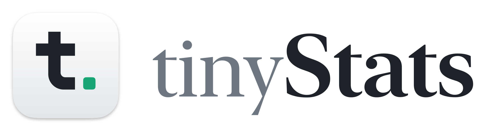

# TinyStats brand

<p align="center">
  <picture>
    <source media="(prefers-color-scheme: dark)" srcset="logo-dark.svg">
    
  </picture>
</p>

## Concept: Lowercase t.

The mark is a square-cut lowercase **t** with a **full stop**: "tiny" and "done" in one letter. The crossbar sits at x-height, the stem turns right into a foot on the baseline, and a mint dot ends the sentence. It's friendly, small and finished, matching the app's job of showing a few values at a glance.

It combines two brand-kit logo methods:

- **Monogram + meaning:** the initial t of TinyStats, with the dot as a full stop.
- **Construction geometry:** one stroke weight, square cuts and a measured grid: guide ticks mark the cap height and baseline, the ascender stops short of the cap line, and the crossbar sits at x-height.

The icon is a native macOS squircle: paper white, an Ink t and one Mint Deep accent.

## Construction

All icon geometry is in a 1024 × 1024, y-down grid. The SVGs and PNGs are generated from the same coordinates in `scripts/create-icon.swift`.

| Element | Master (≥ 64 px) | 32 px | 16 px |
| --- | --- | --- | --- |
| Body (squircle) | 100, 100, 824 × 824, radius 185.4, 60% corner smoothing, drop shadow | 64, 64, 896 × 896, radius 200, no shadow | same as 32 px |
| Stroke | 96 | 3 px | 2 px |
| Stem | x 376–472, from y 248 down to the baseline | px x 11–14, y 7–25 | px x 5–7, y 3–12 |
| Crossbar (x-height) | x 280–584, y 340–436 | px x 8–18, y 11–14 | px x 3–9, y 5–7 |
| Foot (turn at the baseline) | to x 584, baseline y 700, outer radius 120, inner radius 36 | px y 22–25 to x 18, square | px y 10–12 to x 9, square |
| Full stop | 96 × 96 at x 648, baseline, radius 22 | px 21–24 × 22–25 | px 11–13 × 10–12 |
| Guide ticks | cap height y 180 and baseline y 700 | none | none |

- The ascender top (y 248) stops 68 units under the cap-height tick (y 180).
- The body follows Apple's macOS icon grid (824-unit body, 100-unit margin). Corners are continuous, using Figma-style corner smoothing with every segment a cubic Bézier.
- The shadow offsets 10 units down with a 12-unit blur (SVG `stdDeviation`) at 30% black. Raster and SVG shadows are visually equivalent but not pixel-identical; all other geometry matches.

### Small sizes

The 16 and 32 px icons are dedicated masters, not downsampled, used for `icon_16x16`, `icon_16x16@2x` (32 px) and `icon_32x32`.

- Every edge lands on a whole pixel (the body is on a 64-unit / 32-unit grid, 1 px per cell), so nothing antialiases inside the glyph.
- The foot is a solid L-turn, continuous with the stem, with no missing corner pixel (16 px: 2 px deep; 32 px: 3 px). Curved corners are reserved for the 64 px and larger master.
- The dot stays at least 2 px clear of the foot at 16 px and 3 px at 32 px.
- Guide ticks appear only from 64 px up, and not in the lockup.
- To inspect the small masters: `swift scripts/create-icon.swift --check build/brand-check` writes 16× nearest-neighbour enlargements (`build/` is gitignored).

## Palette

| Name | Hex | Use |
| --- | --- | --- |
| Paper Top | `#FFFFFF` | Icon body gradient, top |
| Paper Bottom | `#E2E6EA` | Icon body gradient, bottom |
| Ink | `#1D2228` | The t; "Stats" on light |
| Mint Deep | `#17A673` | Full stop, the only accent |
| Guide | `#C9D0D7` | Cap-height and baseline ticks |
| Frost | `#F3F5F7` | "Stats" on dark |
| Tiny Grey (light) | `#6E7781` | "tiny" on light backgrounds |
| Tiny Grey (dark) | `#9AA3AE` | "tiny" on dark backgrounds |

Mint Deep is the only accent. Don't add a second hue. Presentation backgrounds are `#F5F6F8` (light) and `#15181C` (dark).

## Wordmark

Set "tiny" and "Stats" as one word, `tinyStats`, on a shared baseline. The lowercase "tiny" is lighter and grey; the capital "Stats" is heavier and strong, so the name reads as a small word that carries the stats.

| | Primary: New York | Alternate: SF Pro Rounded |
| --- | --- | --- |
| "tiny" | New York Regular, 94% of the "Stats" size, tracking +0.01 em, lowercase | SF Pro Rounded Regular, same size and tracking |
| "Stats" | New York Semibold, tracking 0 | SF Pro Rounded Bold, tracking 0 |
| Colours, light | "tiny" `#6E7781`, "Stats" `#1D2228` | same |
| Colours, dark | "tiny" `#9AA3AE`, "Stats" `#F3F5F7` | same |

- **Primary** is the logo wordmark (`logo.svg`, `logo-dark.svg`, README and social preview). **Alternate** is for contexts that want a friendlier, UI-native voice. It is documented here and shown in `preview.png`, but no standalone asset is shipped.
- **Join:** the space between the "y" and the "S" is solved optically: its side space matches the mean spacing inside the two words, then it opens by half of any shortfall against the closest ink distance.
- **Lockup:** the icon body is 1.7× the cap height of "Stats", centred on it, with a gap of 0.55 cap heights. Leave the icon's own margin as clear space.
- **Fonts:** the SVGs use outlined glyph paths, so they need no font. The README header uses them. Preview and social PNGs bake in the fonts as rendered on the Mac that generated them (New York and SF Pro are not redistributable, and no font file ships). Every wordmark is laid out and outlined once at 91 pt (New York's text-size cut) and scaled for each output, so the letterforms match in the SVGs and PNGs. The in-app UI uses the system fonts directly.

## Clear space and minimum sizes

- **Clear space:** keep at least the icon's built-in margin (100/1024 of its size) clear around the icon, and the same around the lockup.
- **Minimum sizes:** 16 px for the app icon (the 16 px master). For the lockup, keep the cap height of "Stats" at least 8 px; below that, use the icon alone.

## Do

- Use the icon or lockup on any background. The icon brings its own paper body; use `logo.svg` on light and `logo-dark.svg` on dark.
- Use the 16 and 32 px masters at those sizes rather than scaling the master.
- Regenerate all assets from the script after any change.

## Don't

- Don't recolour the t or the dot, or add gradients, glows or outlines to the glyph.
- Don't round the crossbar, lengthen the ascender to the cap line, or move the full stop off the baseline.
- Don't put text, numbers or extra marks inside the icon.
- Don't use the icon as the menu bar status item. TinyStats shows live text readouts there.
- Don't set "tiny" in capitals or small caps, or mix the primary and alternate faces in one wordmark.
- Don't stretch, rotate or crop the squircle.

## Files

| File | What |
| --- | --- |
| `docs/brand/logo.svg` | Lockup (icon + primary wordmark) for light backgrounds, outlined text |
| `docs/brand/logo-dark.svg` | Same lockup with the dark-background wordmark colours |
| `docs/brand/logo-mark.svg` | App icon alone (1024 viewBox, with guide ticks) |
| `docs/brand/social-preview.png` | 1280 × 640 GitHub social preview |
| `docs/brand/preview.png` | Review sheet: icon sizes and both wordmarks on light and dark |
| `Resources/AppIcon.iconset/` | 10 PNGs, `icon_16x16` to `icon_512x512@2x` |
| `Resources/TinyStats.icns` | Built by `iconutil`; copied into the app by `scripts/build-app.sh` |
| `scripts/create-icon.swift` | Single source of truth for all geometry, colours and renders |
| `scripts/generate-brand.sh` | Regenerates everything above |

## Regenerating

```sh
scripts/generate-brand.sh
```

This needs only Swift, AppKit, CoreText and `iconutil`, and the New York and SF Pro Rounded system fonts (macOS 14+). Output is deterministic on a given macOS version; glyph outlines and PNG text can differ slightly across OS font versions. Builds copy the committed `Resources/TinyStats.icns`, so app packaging doesn't depend on render output. Commit the regenerated files together with any change to `scripts/create-icon.swift`.
